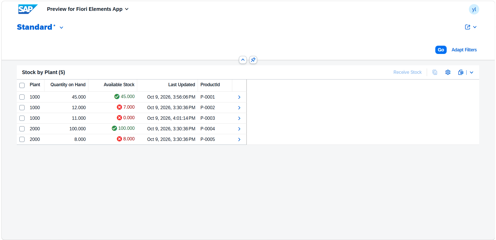
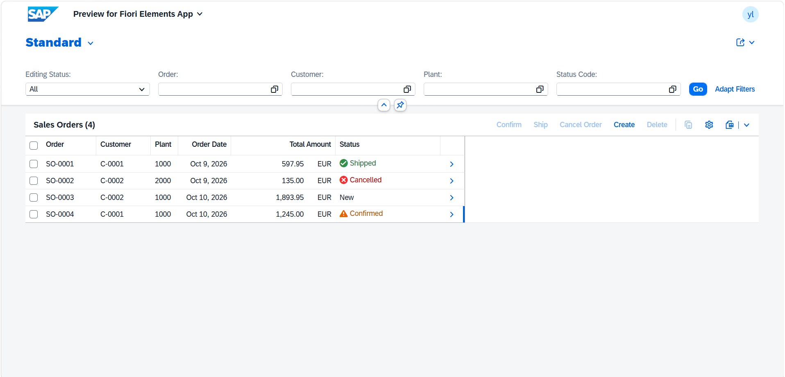
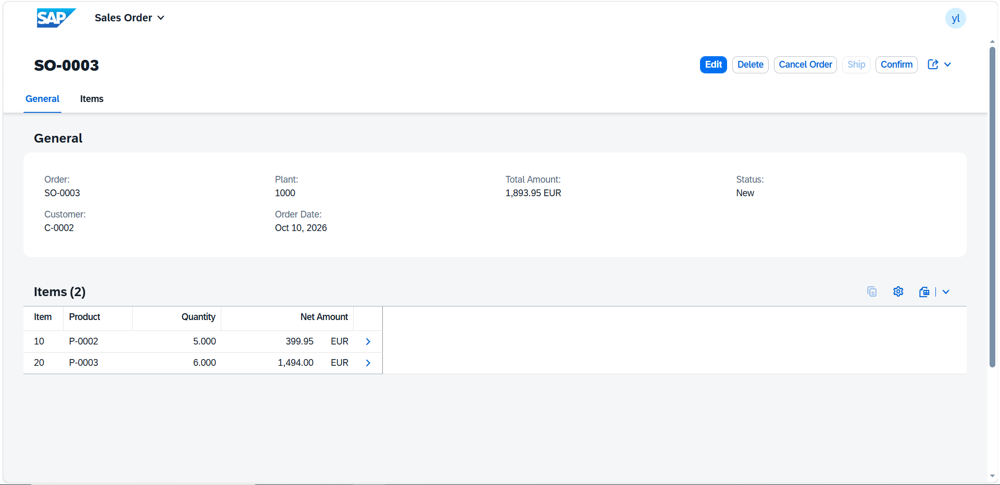
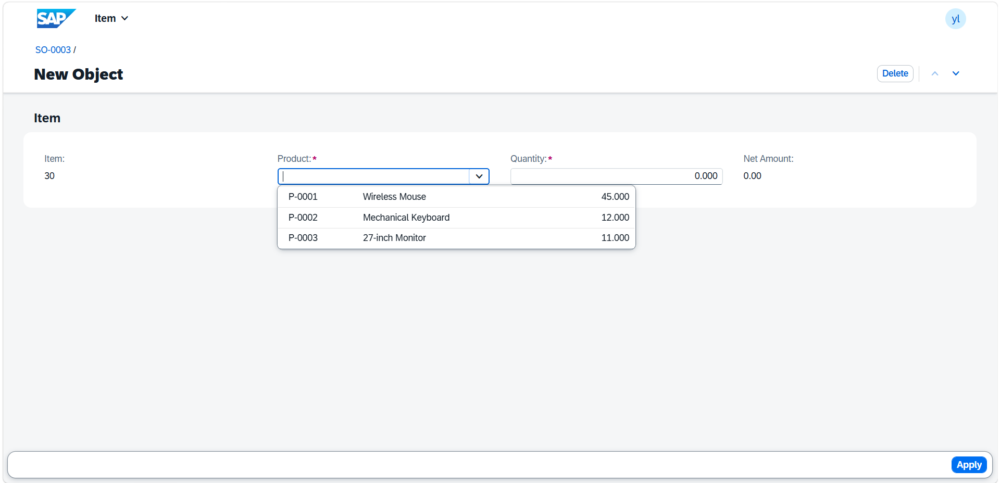
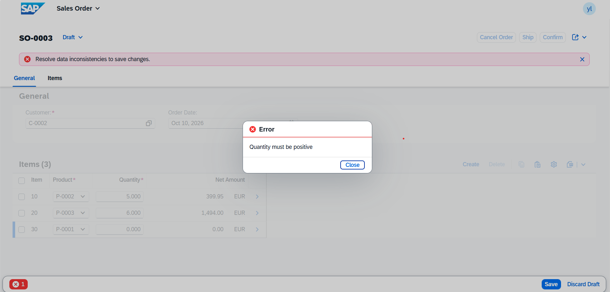
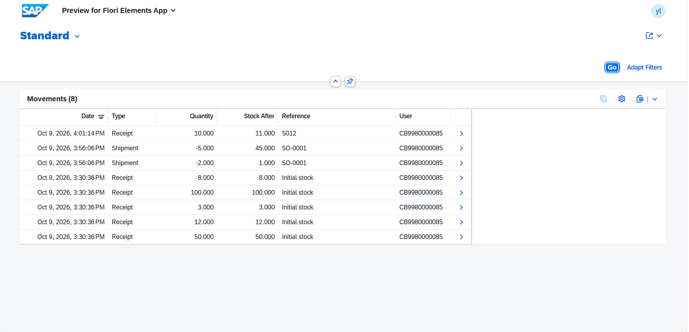
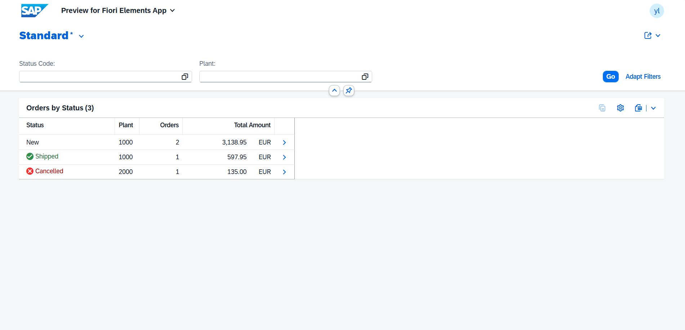
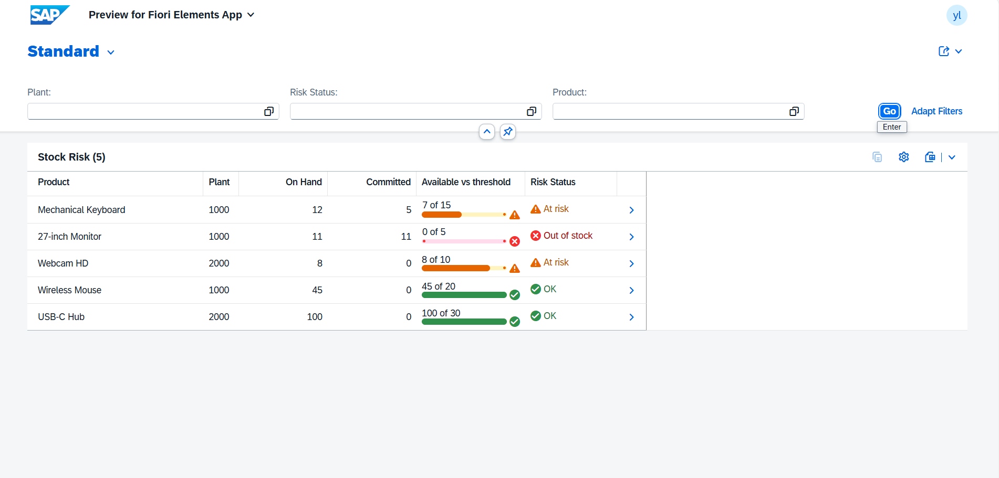
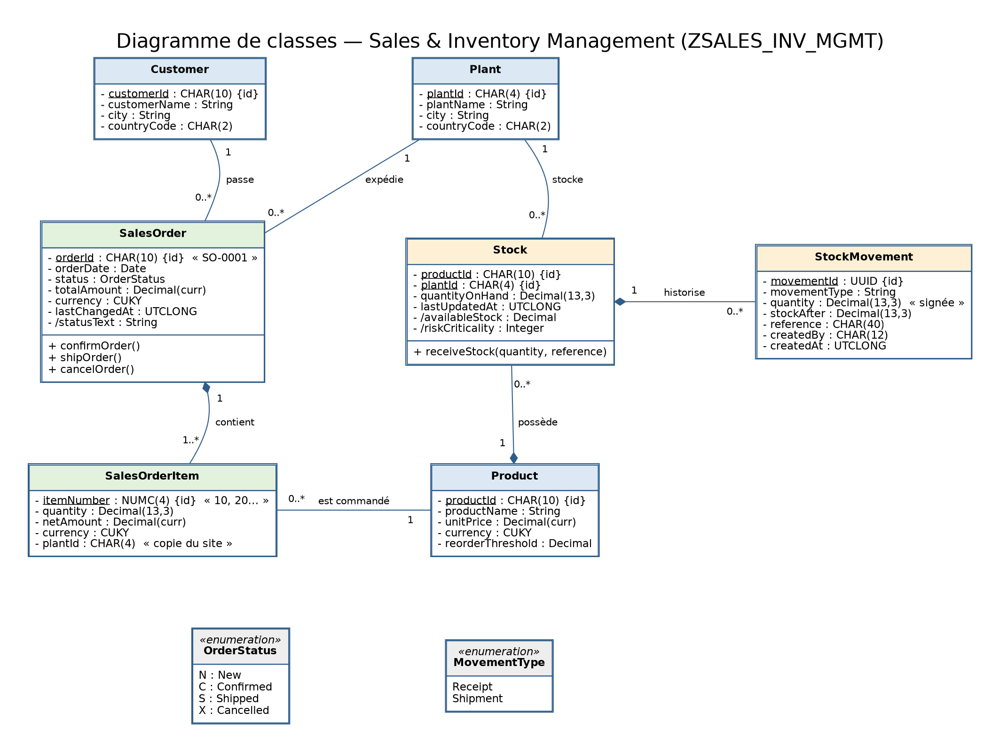
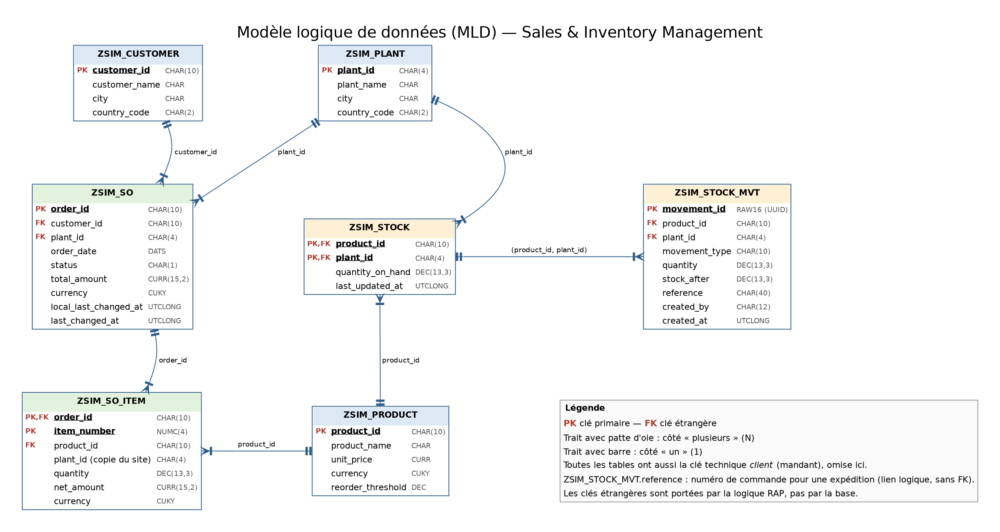

# SAP Sales & Inventory Management


A sales order and stock management application built with the **ABAP RESTful Application Programming Model (RAP)** on **ABAP Cloud**, with **SAP Fiori Elements** user interfaces.

Users create multi-line sales orders, follow them from confirmation to shipment, receive stock on a site, and see at a glance which products are at risk of running out. Stock is tracked **per product and per plant**, and every stock movement is recorded in a history.

> Personal portfolio project, developed on an ABAP Cloud practice system with ABAP Development Tools (Eclipse). It is not connected to a real S/4HANA landscape.

---

## Table of contents

1. [Key features](#key-features)
2. [Screenshots](#screenshots)
3. [Business rules](#business-rules)
4. [Order lifecycle](#order-lifecycle)
5. [Architecture](#architecture)
6. [Data model](#data-model)
7. [Technical highlights](#technical-highlights)
8. [Code excerpt](#code-excerpt)
9. [Repository structure](#repository-structure)
10. [Getting started](#getting-started)
11. [Demo walkthrough](#demo-walkthrough)
12. [Challenges and lessons learned](#challenges-and-lessons-learned)
13. [Known limitations](#known-limitations)
14. [Roadmap](#roadmap)
15. [Documentation](#documentation)
16. [About the author](#about-the-author)
17. [License](#license)

---

## Key features

### Product and stock (application *Product*)
- Product catalog with price and reorder threshold.
- **Stock by plant**: physical stock, available stock, and a red or green indicator when the available stock is below the reorder threshold.
- **Receive Stock** action: add received quantity to a plant, with a free reference (delivery note, purchase order).
- **Movement history** for each stock line: date, type (`Receipt` or `Shipment`), signed quantity, stock after the movement, reference, user.

### Sales orders (application *Sales Order*)
- Create and edit orders with **draft** support: Create, Edit, Save, Discard, resume an unsaved draft.
- Multi-line orders with automatic numbering (`SO-0001`, items `10`, `20`, …).
- Product choice **limited to products that have stock on the order's plant**.
- **Blocking stock check**: an order cannot be saved if a line exceeds the available stock of its plant. Messages are explicit (`no stock at plant X`, `requested N exceeds available stock M`).
- **Amounts**: line amount (quantity × unit price) and order total, recalculated on every change, including line deletion.
- **Lifecycle actions**: Confirm, Ship, Cancel, enabled or disabled according to the status. A shipped order decreases the physical stock and writes a movement.
- Colored status, filters (plant, status code, order, customer), edit and delete allowed only for new orders.

### Dashboard (application *Orders by Status* and *Stock Risk*)
- **Orders by Status**: number of orders and total amount per status and plant, statuses colored and sorted in lifecycle order.
- **Stock Risk**: one row per product and plant with physical, committed and available stock, a progress bar comparing the available stock with the reorder threshold, and a risk status (`OK`, `At risk`, `Out of stock`).
- Values are computed **in SQL (CDS)**, so they can be filtered and sorted in the UI.

---

## Screenshots

| | |
|---|---|
|  |  |
| *Stock by plant with risk indicator* | *Sales order list with colored statuses* |
|  |  |
| *Order with line amounts and total* | *Products filtered by the order's plant* |
|  |  |
| *Blocking stock check* | *Stock movement history* |
|  |  |
| *Dashboard: orders by status* | *Dashboard: stock risk* |

---

## Business rules

| # | Rule |
|---|---|
| R1 | A new order starts in status `N` (New). |
| R2 | The order date cannot be in the future. |
| R3 | A line quantity must be positive. |
| R4 | **Available stock** = physical stock of the plant − quantities of the New or Confirmed orders of that plant. |
| R5 | A product is **at risk** when its available stock is below its reorder threshold. |
| R6 | An order cannot be saved if, for a product, the requested quantity exceeds the available stock of the plant (the order itself is excluded from the committed quantity). |
| R7 | Products offered in a line are those with stock on the order's plant. If the plant changes, the lines follow. |
| R8 | Line amount = quantity × unit price. Order total = sum of the line amounts. |
| R9 | Only a New order can be confirmed, and it needs at least one line. |
| R10 | Only a Confirmed order can be shipped, and the physical stock must cover each line. |
| R11 | Only a New or Confirmed order can be cancelled. |
| R12 | An order can be edited or deleted only while it is New. |
| R13 | Shipping decreases the physical stock and writes a negative `Shipment` movement. Receiving stock writes a positive `Receipt` movement. |
| R14 | Two users cannot overwrite each other's changes (ETag). |

---

## Order lifecycle

```
        Confirm              Ship
 New ───────────▶ Confirmed ───────────▶ Shipped      (physical stock decreased)
  │ N                │ C                    S
  │ Cancel           │ Cancel
  ▼                  ▼
        Cancelled  X
```

| Status | Color | Counts as committed stock | Editable |
|---|---|---|---|
| New (`N`) | neutral | yes | yes |
| Confirmed (`C`) | yellow | yes | no |
| Shipped (`S`) | green | no, physical stock already decreased | no |
| Cancelled (`X`) | red | no | no |

---

## Architecture

The project follows the complete RAP chain, from the database tables to the Fiori applications.

```
ABAP Dictionary tables (+ draft tables)
        ↓
CDS View Entities (semantic model, associations, compositions)
        ↓
Behavior Definitions (CRUD, draft, determinations, validations, actions)
        ↓
CDS Projections  +  Behavior Projections (what the UI can use)
        ↓
Metadata Extensions (Fiori annotations)
        ↓
Service Definitions  →  Service Bindings (OData V4 - UI)
        ↓
Fiori Elements applications
```

### Business objects

```
Product BO                          Sales Order BO (with draft)
  Product (root)                      SalesOrder (root)
    └── Stock (product + plant)         └── SalesOrderItem
          └── StockMovement
```

### Services

| Service definition | Service binding | Applications |
|---|---|---|
| `ZSIM_UI_PRODUCT` | `ZSIM_UI_PRODUCT_O4` | Product, stock by plant, movement history, Receive Stock |
| `ZSIM_UI_SALESORDER` | `ZSIM_UI_SALESORDER_O4` | Sales orders and items, lifecycle actions |
| `ZSIM_UI_DASHBOARD` | `ZSIM_UI_DASHBOARD_O4` | Orders by Status, Stock Risk |

### Naming convention

`ZSIM_I_*` interface views · `ZSIM_C_*` consumption (projection) views · `ZSIM_UI_*` services · `*_O4` OData V4 bindings · `ZBP_*` behavior pools · `ZCL_*` classes.

---

## Data model





| Table | Key | Role |
|---|---|---|
| `ZSIM_PLANT` | `plant_id` | Plants |
| `ZSIM_PRODUCT` | `product_id` | Products with price and reorder threshold |
| `ZSIM_CUSTOMER` | `customer_id` | Customers |
| `ZSIM_STOCK` | `product_id`, `plant_id` | Physical stock per product and plant |
| `ZSIM_STOCK_MVT` | `movement_id` (UUID) | Stock movement history |
| `ZSIM_SO` | `order_id` | Order header (status, total, ETag fields) |
| `ZSIM_SO_ITEM` | `order_id`, `item_number` | Order lines (product, plant, quantity, amount) |
| `ZSIM_SO_D`, `ZSIM_SO_ITEM_D` | | Technical draft tables |

Derived values are **not stored**: available stock, risk indicator and status text are computed when read. The full data dictionary is in [`documentation/conception_base_de_donnees.md`](documentation/conception_base_de_donnees.md).

---

## Technical highlights

| Topic | What the project demonstrates |
|---|---|
| **Managed RAP with draft** | Draft on the order (two levels), with `Prepare` running validations and recalculation before activation. |
| **Three-level composition** | Product → Stock → StockMovement in one business object. |
| **Early numbering** | `SO-0001`-style keys, aware of existing drafts; key reuse on draft activation. |
| **Determinations and validations** | `on modify` and `on save` determinations, validations with messages bound to fields. |
| **Actions with feature control** | `confirmOrder`, `shipOrder`, `cancelOrder` enabled or disabled per instance; `update`, `delete` and `Edit` controlled by status. |
| **Action with parameters** | `receiveStock` with an abstract entity (quantity, reference), creating a child movement in the same transaction through EML. |
| **Additional save** | Shipping decreases the physical stock and logs a movement in `save_modified`, in the same LUW as the status change. |
| **ETag** | `etag master` and `lock master total etag`. |
| **Virtual elements** | Available stock and risk indicator (SADL calculation exit); status text and color on a projection, so they also work on drafts. |
| **Value help with additional binding** | Product value help filtered by the plant of the order line. |
| **SQL analytics in CDS** | Aggregation, left outer join, `case`, `division`, `coalesce`, layered views for the dashboard. |
| **Fiori Elements annotations** | Criticality, action buttons, selection fields, presentation variants, data point with progress bar. |
| **Clean Core** | Only own objects and released APIs. |

---

## Code excerpt

Behavior definition of the sales order (excerpt):

```abap
define behavior for ZSIM_I_SALESORDER alias SalesOrder
persistent table zsim_so
with additional save
draft table zsim_so_d
etag master LocalLastChangedAt
lock master total etag LastChangedAt
authorization master ( instance )
early numbering
{
  create;
  update ( features : instance );
  delete ( features : instance );

  determination setInitialStatus on modify { create; }
  determination syncItemsPlant   on modify { field PlantId; }
  determination recalculateTotal on save   { create; field CustomerId, PlantId, OrderDate; }

  validation validateOrderDate on save { create; field OrderDate; }

  action ( features : instance ) confirmOrder result [1] $self;
  action ( features : instance ) shipOrder    result [1] $self;
  action ( features : instance ) cancelOrder  result [1] $self;

  draft action ( features : instance ) Edit;
  draft action Activate optimized;
  draft action Discard;
  draft action Resume;
  draft determine action Prepare { ... }

  association _Items { create; with draft; }
  ...
}
```

The available stock rule, shared by the application and the dashboard:

```
available stock = physical stock − Σ quantity of orders in status New or Confirmed
                                   (same product, same plant)
at risk         = available stock < reorder threshold
```

---

## Repository structure

```
.
├── .abapgit.xml           abapGit configuration
├── README.md
├── LICENSE
├── architecture/          UML class diagram, logical data model
├── documentation/         functional and technical documentation
├── screenshots/           application screenshots
└── src/                   ABAP sources serialized by abapGit
```

The `src/` folder is generated by [abapGit](https://abapgit.org/): each ABAP object is stored as a source file plus an XML metadata file, for example `zbp_sim_i_product.clas.abap` and `zbp_sim_i_product.clas.xml`. The file `package.devc.xml` describes the package `ZSALES_INV_MGMT`.

---

## Getting started

### Prerequisites

- An **ABAP Cloud** system (SAP BTP ABAP Environment) with the authorization to create a package and development objects.
- **ABAP Development Tools** (ADT) in Eclipse, with the **abapGit plugin for ADT** (update site: `http://eclipse.abapgit.org/updatesite/`).

### Setup

1. In ADT, create the package `ZSALES_INV_MGMT` (with a transport request).
2. Import the sources with abapGit:
   1. Open the view **Window → Show View → Other… → abapGit Repositories**.
   2. Click **+** (Link abapGit Repository) and enter the URL of this repository: `https://github.com/yassinelaamarti/sap-abap-rap-sales-inventory-management.git`.
   3. Branch `refs/heads/main`, package `ZSALES_INV_MGMT`, folder logic **FULL**, then select your transport request.
   4. Right-click the linked repository and choose **Pull…**.
   5. Run **Activate Inactive ABAP Development Objects** (mass activation) on the package. If some objects fail because of dependencies, activate again until no inactive object is left.

3. In each service binding (OData V4 - UI), click **Publish**. The bindings are imported but not published by abapGit.
4. Run the console class `ZCL_SIM_DATA_SETUP` (**F9**) to create the test data.
5. In a service binding, select an entity set and click **Preview**: `Product`, `SalesOrder`, `OrderStatusKpi`, `StockRisk`.

If a preview shows outdated annotations, unpublish and publish the binding again, then open the preview in a private browser window.

### Test data

`ZCL_SIM_DATA_SETUP` empties the project tables and creates:

| Data | Content |
|---|---|
| Plants | `1000` Paris, `2000` Lyon |
| Products | 5, with different reorder thresholds |
| Customers | 3 |
| Stock | Mouse 50, Keyboard 12, Monitor 3 (plant 1000); USB-C Hub 100, Webcam 8 (plant 2000), each with an initial `Receipt` movement |
| Orders | `SO-0001` (plant 1000, 597.95 EUR) and `SO-0002` (plant 2000, 135.00 EUR), both New |

Run it again at any time to return to this state.

---

## Demo walkthrough

| Step | Action | What to observe |
|---|---|---|
| 1 | Open *Product*, then a product's stock | Available stock and risk indicator per plant |
| 2 | In *Sales Order*, **Create** an order on plant `1000` | A draft with its number; the product value help lists only the products of that plant |
| 3 | Request more than the available quantity, then **Save** | Blocking error with an explicit message |
| 4 | Fix the quantity, **Save** | Order created, total computed from the line amounts |
| 5 | **Edit** the order, delete a line, **Save** | Total recalculated |
| 6 | **Confirm** the order | Status Confirmed, **Edit** and **Delete** no longer available |
| 7 | **Ship** the order | Status Shipped; in *Product*, physical stock decreased and a `Shipment` movement appears |
| 8 | In *Product*, **Receive Stock** on a stock line | Physical stock increased and a `Receipt` movement appears |
| 9 | Open the dashboard | Orders by status and stock risk reflect these actions |

---

## Challenges and lessons learned

| Problem | Cause | Solution |
|---|---|---|
| Fiori error `Unable to find annotationPath` | The stock entity was not exposed in the service | Expose the child entity in the service definition |
| Short dump `INSTANCE_AUTHORIZATION` / `GLOBAL_AUTHORIZATION` handler not implemented | An authorization declaration without its handler method | Implement the matching handler in the behavior pool |
| Dump when activating a draft (`en_no_failed_no_mapped`) | Early numbering returned nothing for instances that already have a key | Return the existing key on activation |
| Status empty on a draft | A calculated field in a base CDS view is not recomputed for drafts | Compute it in a projection virtual element from the stored status |
| `Prepare` refuses a determination | `Prepare` accepts only `on save` determinations with a trigger | Use an `on save` determination |
| Dump `cyclical triggering of on-save determinations` | An `update` trigger on a determination that modifies its own entity | Restrict triggers to creation and fields the determination does not change |
| Total not recalculated after deleting a line | The header determination is not triggered by a line deletion | `on save { delete; }` determination on the line |
| Table error `Properties do not have unique keys` | Two columns pointing to the same property | One column per property; use a dedicated element for the progress bar |
| Charts not displayed | The analytical query is refused by the OData V4 - UI service binding, and a chart on the cube or on the aggregated view is not rendered | Replaced by an enriched table (colors, icons, progress bar) |

---

## Known limitations

- CDS access control by plant and user is not implemented yet.
- Server-side validation of customer, plant, and product existence needs improvement.
- Automated ABAP Unit tests are not implemented yet.
- Stock updates use ABAP SQL; a production implementation would require a dedicated stock-management API or business object.
- Order numbering could be replaced with a dedicated number range object.

---

## Roadmap

- [ ] Implement CDS access control, including dashboard views.
- [ ] Add ABAP Unit tests for stock calculations, validations, totals, and order lifecycle.
- [ ] Strengthen server-side business validations.
- [ ] Improve stock handling and order numbering for production readiness.

---

## Documentation

| Resource | Content |
|---|---|
| [`documentation/conception_base_de_donnees.md`](documentation/conception_base_de_donnees.md) | Full data dictionary: tables, fields, keys |
| [`architecture/uml-class-diagram.png`](architecture/uml-class-diagram.png) | UML class diagram |
| [`architecture/mld.png`](architecture/mld.png) | Logical data model |

---

## About the author

**Yassine Laamarti** — fifth-year engineering student in Information Systems Management and Governance (MGSI) at ENSIASD, Morocco.

Currently seeking a **Final-Year Project Internship (PFE) starting in January 2027**, with a focus on SAP ABAP Cloud, RAP, and SAP Fiori Elements.

- SAP Certified Associate — Back-End Developer — ABAP Cloud (C_ABAPD_2601), 29 September 2026, score: 100%.
- SAP Certified — Backend Developer — SAP Cloud Application Programming Model (C_CPE_2601), 14 September 2026, score: 100%.

[LinkedIn](https://www.linkedin.com/in/yassine-laamarti/) · [GitHub](https://github.com/yassinelaamarti)

---

## License

Personal portfolio project built on an SAP training system. Released under the [MIT License](LICENSE).
