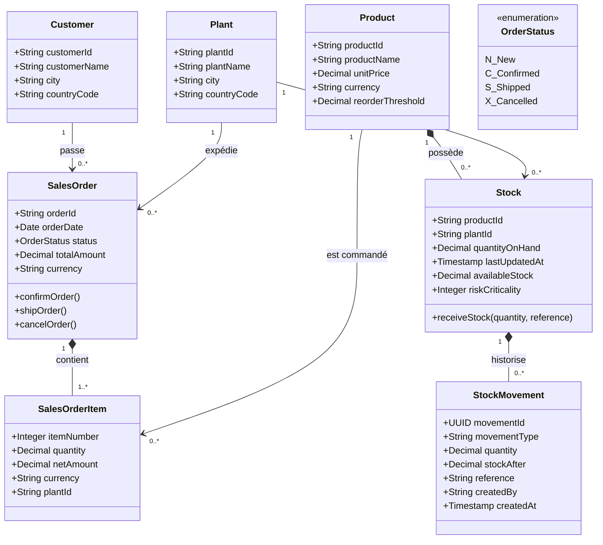
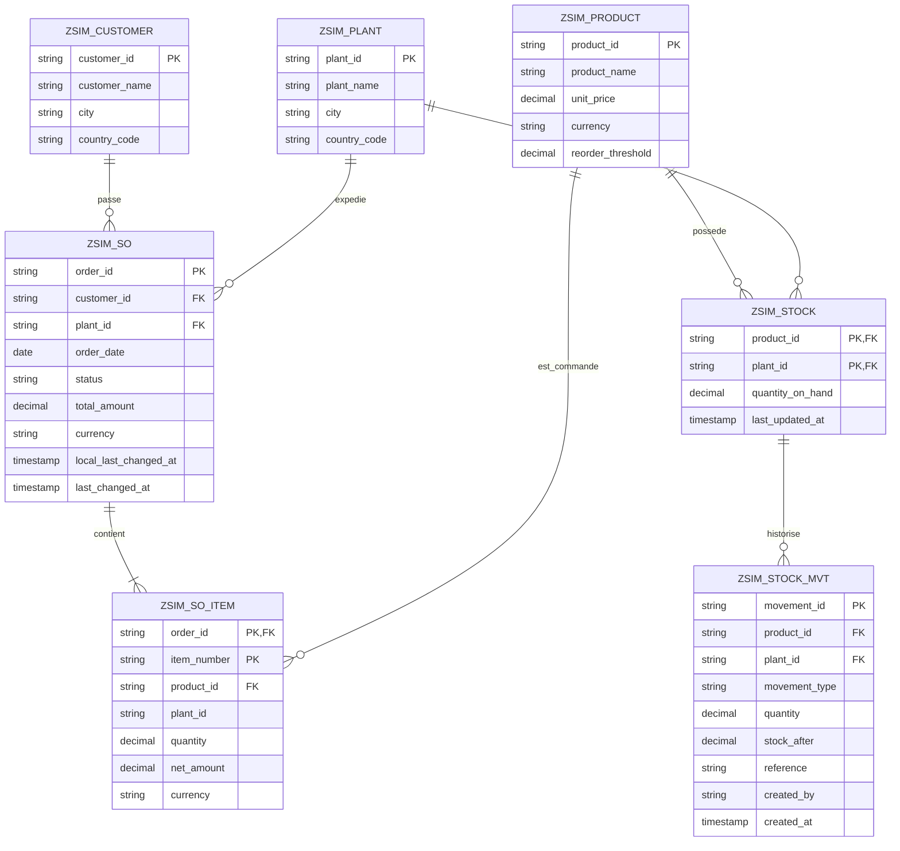

# Conception globale de la base de données — Sales & Inventory Management

Package `ZSALES_INV_MGMT` — état du projet : octobre 2026

Ce document décrit le modèle de données du projet : règles de gestion, diagramme de classes UML, modèle logique de données (MLD), dictionnaire de données, contraintes d'intégrité et correspondance avec les couches RAP.

Diagrammes fournis avec ce document :

| Fichier | Contenu |
|---|---|
| `diagramme_classes_UML.png` (et `.svg`) | Diagramme de classes UML |
| `diagramme_MLD.png` (et `.svg`) | Modèle logique de données |

---

## 1. Périmètre et conventions

Le modèle couvre **sept entités persistantes** :

| Entité métier | Table | Rôle |
|---|---|---|
| Client | `ZSIM_CUSTOMER` | destinataire des commandes |
| Site | `ZSIM_PLANT` | établissement où le stock est localisé et d'où la commande est expédiée |
| Produit | `ZSIM_PRODUCT` | article vendable, avec prix et seuil de réapprovisionnement |
| Stock | `ZSIM_STOCK` | stock physique d'un produit sur un site |
| Mouvement de stock | `ZSIM_STOCK_MVT` | historique des entrées et sorties de stock |
| Commande | `ZSIM_SO` | en-tête de commande |
| Ligne de commande | `ZSIM_SO_ITEM` | produit et quantité commandés |

Conventions :

- Toutes les tables ont une première clé technique `client` (mandant SAP), qui n'est pas représentée dans les diagrammes.
- Les types sont **indicatifs** : ceux du dictionnaire ABAP font foi.
- Les **données dérivées** (stock disponible, risque, texte du statut) ne sont pas stockées : voir la section 7.

---

## 2. Règles de gestion

| # | Règle |
|---|---|
| RG1 | Un client passe zéro ou plusieurs commandes ; une commande appartient à un seul client. |
| RG2 | Une commande est expédiée depuis un seul site ; un site expédie zéro ou plusieurs commandes. |
| RG3 | Une commande contient au moins une ligne ; une ligne appartient à une seule commande. Supprimer une commande supprime ses lignes. |
| RG4 | Une ligne concerne un seul produit ; un produit peut figurer dans zéro ou plusieurs lignes. |
| RG5 | Le stock est suivi **par produit et par site** : un couple (produit, site) a au plus une ligne de stock. |
| RG6 | Chaque variation du stock physique est tracée par un mouvement (`Receipt` pour une entrée, `Shipment` pour une sortie). Un mouvement appartient à une seule ligne de stock. |
| RG7 | Une commande a un statut : `N` (New), `C` (Confirmed), `S` (Shipped), `X` (Cancelled). Elle n'est modifiable ou supprimable que si elle est New. |
| RG8 | Le montant d'une ligne est la quantité multipliée par le prix du produit ; le total de la commande est la somme des montants de ses lignes. |
| RG9 | Le stock disponible d'un produit sur un site est le stock physique moins les quantités des commandes New ou Confirmed de ce site. Une commande ne peut pas dépasser ce disponible. |
| RG10 | Un produit est en risque de rupture si son disponible est inférieur à son seuil de réapprovisionnement. |
| RG11 | L'expédition d'une commande diminue le stock physique de chaque ligne et crée un mouvement `Shipment` de quantité négative. |
| RG12 | La réception de stock augmente le stock physique et crée un mouvement `Receipt` de quantité positive. |

---

## 3. Diagramme de classes UML


### Lecture du diagramme

| Élément | Signification |
|---|---|
| Losange plein (composition) | `SalesOrder` ◆ `SalesOrderItem`, `Product` ◆ `Stock`, `Stock` ◆ `StockMovement` : la partie n'existe pas sans son tout, et disparaît avec lui. Cette hiérarchie est celle des objets métier RAP. |
| `Stock` | classe d'association entre `Product` et `Plant` : son identifiant est le couple (`productId`, `plantId`). |
| Attributs précédés de `/` | attributs **dérivés**, calculés et non stockés (`availableStock`, `riskCriticality`, `statusText`). |
| Opérations | actions métier : `confirmOrder`, `shipOrder`, `cancelOrder` sur la commande ; `receiveStock` sur le stock. |
| `«enumeration»` | valeurs autorisées des types `OrderStatus` et `MovementType`. |

### Choix de modélisation

- **Composition `Product` ◆ `Stock`** : elle reflète la hiérarchie RAP (le stock se consulte depuis le produit). Le stock est aussi lié au site par une association simple.
- **`SalesOrderItem.plantId`** : copie du site de la commande, tenue à jour par le système. Elle permet de filtrer les produits proposés sur le site, y compris pendant la saisie.
- **`StockMovement`** a un identifiant propre (UUID) plutôt qu'une clé composée : les mouvements sont nombreux et ne sont jamais modifiés.

---

## 4. Modèle logique de données (MLD)


### Règles de passage du modèle de classes au MLD

| Règle | Application |
|---|---|
| Une classe devient une table. | 7 tables |
| Dans une association 1–N, la clé primaire du côté 1 migre comme clé étrangère du côté N. | `customer_id` et `plant_id` dans `ZSIM_SO`, `product_id` dans `ZSIM_SO_ITEM`, etc. |
| Dans une composition, l'identifiant du composite entre dans la clé du composant. | `ZSIM_SO_ITEM` : clé (`order_id`, `item_number`) ; `ZSIM_STOCK` : clé (`product_id`, `plant_id`) |
| Un composant à fort volume reçoit un identifiant propre. | `ZSIM_STOCK_MVT` : clé `movement_id`, avec clé étrangère composée vers le stock |
| Les attributs dérivés ne sont pas stockés. | `availableStock`, `riskCriticality`, `statusText` n'ont pas de colonne |
| Une énumération devient une colonne de type caractère aux valeurs contrôlées. | `status`, `movement_type` |

### Notation relationnelle

Convention : **gras** = clé primaire, `#` = clé étrangère.

```
ZSIM_CUSTOMER   ( **customer_id**, customer_name, city, country_code )

ZSIM_PLANT      ( **plant_id**, plant_name, city, country_code )

ZSIM_PRODUCT    ( **product_id**, product_name, unit_price, currency, reorder_threshold )

ZSIM_STOCK      ( **#product_id**, **#plant_id**, quantity_on_hand, last_updated_at )
                  #product_id  → ZSIM_PRODUCT
                  #plant_id    → ZSIM_PLANT

ZSIM_STOCK_MVT  ( **movement_id**, #product_id, #plant_id, movement_type, quantity,
                  stock_after, reference, created_by, created_at )
                  (#product_id, #plant_id) → ZSIM_STOCK

ZSIM_SO         ( **order_id**, #customer_id, #plant_id, order_date, status, total_amount,
                  currency, local_last_changed_at, last_changed_at )
                  #customer_id → ZSIM_CUSTOMER
                  #plant_id    → ZSIM_PLANT

ZSIM_SO_ITEM    ( **#order_id**, **item_number**, #product_id, plant_id, quantity,
                  net_amount, currency )
                  #order_id    → ZSIM_SO
                  #product_id  → ZSIM_PRODUCT
```

`ZSIM_SO_ITEM.plant_id` est une copie de `ZSIM_SO.plant_id` : elle n'est pas déclarée comme clé étrangère, car sa valeur est imposée par la commande.

---

## 5. Dictionnaire de données

### `ZSIM_CUSTOMER`

| Colonne | Type | Clé | Description |
|---|---|---|---|
| `customer_id` | CHAR(10) | PK | identifiant client (ex. `C-0001`) |
| `customer_name` | CHAR | | nom |
| `city` | CHAR | | ville |
| `country_code` | CHAR(2) | | pays |

### `ZSIM_PLANT`

| Colonne | Type | Clé | Description |
|---|---|---|---|
| `plant_id` | CHAR(4) | PK | identifiant du site (ex. `1000`) |
| `plant_name` | CHAR | | nom |
| `city` | CHAR | | ville |
| `country_code` | CHAR(2) | | pays |

### `ZSIM_PRODUCT`

| Colonne | Type | Clé | Description |
|---|---|---|---|
| `product_id` | CHAR(10) | PK | identifiant produit (ex. `P-0001`) |
| `product_name` | CHAR | | désignation |
| `unit_price` | CURR | | prix unitaire |
| `currency` | CUKY | | devise du prix |
| `reorder_threshold` | DEC | | seuil de réapprovisionnement |

### `ZSIM_STOCK`

| Colonne | Type | Clé | Description |
|---|---|---|---|
| `product_id` | CHAR(10) | PK, FK | produit |
| `plant_id` | CHAR(4) | PK, FK | site |
| `quantity_on_hand` | DEC(13,3) | | stock physique |
| `last_updated_at` | UTCLONG | | date de la dernière variation |

### `ZSIM_STOCK_MVT`

| Colonne | Type | Clé | Description |
|---|---|---|---|
| `movement_id` | RAW16 (UUID) | PK | identifiant du mouvement |
| `product_id` | CHAR(10) | FK | produit |
| `plant_id` | CHAR(4) | FK | site |
| `movement_type` | CHAR(10) | | `Receipt` ou `Shipment` |
| `quantity` | DEC(13,3) | | quantité **signée** : positive pour une entrée, négative pour une sortie |
| `stock_after` | DEC(13,3) | | stock physique après le mouvement |
| `reference` | CHAR(40) | | référence libre pour une réception (bon de livraison…), numéro de commande pour une expédition (lien logique, sans clé étrangère) |
| `created_by` | CHAR(12) | | utilisateur |
| `created_at` | UTCLONG | | date et heure |

### `ZSIM_SO`

| Colonne | Type | Clé | Description |
|---|---|---|---|
| `order_id` | CHAR(10) | PK | numéro de commande (`SO-0001`) |
| `customer_id` | CHAR(10) | FK | client |
| `plant_id` | CHAR(4) | FK | site d'expédition |
| `order_date` | DATS | | date de commande (jamais dans le futur) |
| `status` | CHAR(1) | | `N`, `C`, `S` ou `X` |
| `total_amount` | CURR(15,2) | | somme des montants de lignes |
| `currency` | CUKY | | devise du total |
| `local_last_changed_at` | UTCLONG | | ETag local |
| `last_changed_at` | UTCLONG | | ETag total |

### `ZSIM_SO_ITEM`

| Colonne | Type | Clé | Description |
|---|---|---|---|
| `order_id` | CHAR(10) | PK, FK | commande |
| `item_number` | NUMC(4) | PK | numéro de ligne (10, 20, …) |
| `product_id` | CHAR(10) | FK | produit commandé |
| `plant_id` | CHAR(4) | | copie du site de la commande |
| `quantity` | DEC(13,3) | | quantité (strictement positive) |
| `net_amount` | CURR(15,2) | | quantité × prix unitaire |
| `currency` | CUKY | | devise du montant |

---

## 6. Contraintes d'intégrité

### Contraintes de domaine

| Contrainte | Où elle est appliquée |
|---|---|
| `status` ∈ {`N`, `C`, `S`, `X`} | détermination `setInitialStatus` et actions `confirmOrder`, `shipOrder`, `cancelOrder` |
| `movement_type` ∈ {`Receipt`, `Shipment`} | action `receiveStock` et saveur de l'expédition |
| `quantity` d'une ligne > 0 | validation `validateQuantities` |
| `order_date` ≤ date du jour | validation `validateOrderDate` |
| Quantité d'une ligne ≤ stock disponible du site | validation `checkStockAvailability` |
| Quantité reçue > 0 | action `receiveStock` |

### Contraintes d'intégrité référentielle

Les tables ABAP du projet **ne portent pas de clés étrangères déclarées en base** : l'intégrité référentielle est assurée par l'objet métier RAP.

| Lien | Mécanisme |
|---|---|
| commande → ses lignes | composition : les lignes sont supprimées avec la commande ; une ligne ne peut être créée que dans une commande |
| produit → ses stocks, stock → ses mouvements | composition RAP |
| ligne → produit, commande → client, commande → site | aide à la saisie qui limite les choix |

**Limite connue** : aucune validation côté serveur ne vérifie que le client, le site ou le produit saisi existe réellement. Seule l'aide à la saisie contraint le choix dans l'interface. Ajouter ces validations est une amélioration à prévoir (section 9).

### Invariants du modèle

| Invariant | Garanti par |
|---|---|
| Total d'une commande = somme des montants de ses lignes | déterminations de montant et de total |
| Site d'une ligne = site de sa commande | déterminations `setItemPlant` et `syncItemsPlant` |
| Stock physique = somme des mouvements de son historique | action `receiveStock`, sauvegarde de l'expédition, et réception initiale créée par le jeu de test |
| Une commande Shipped n'est plus modifiable | contrôle de fonctionnalités par instance |

---

## 7. Données dérivées (non stockées)

| Donnée | Calcul | Où |
|---|---|---|
| `AvailableStock` | stock physique − Σ quantités des commandes New ou Confirmed (même produit, même site) | classe `ZCL_SIM_STOCK_CALC` (application Product) ; vues CDS `ZSIM_I_STOCKPOSITION` (tableau de bord) |
| `RiskCriticality` | rouge si `AvailableStock` < `reorder_threshold`, sinon vert | classe `ZCL_SIM_STOCK_CALC` |
| `StatusText`, `StatusCriticality` | texte et couleur du statut | classe `ZCL_SIM_ORDER_STATUS_CALC` |
| Commandes par statut, stock à risque | agrégations SQL | vues CDS du tableau de bord |

**Pourquoi ne pas les stocker** : un disponible stocké devrait être mis à jour à chaque commande, confirmation, annulation, expédition et réception. Le calculer à la lecture évite toute divergence.

---

## 8. Correspondance avec les couches RAP

| Entité | Table | CDS de base | CDS de projection | Objet métier (BDEF) |
|---|---|---|---|---|
| Client | `ZSIM_CUSTOMER` | `ZSIM_I_CUSTOMER` | `ZSIM_C_CUSTOMER` | `ZSIM_I_CUSTOMER` (lecture seule) |
| Site | `ZSIM_PLANT` | `ZSIM_I_PLANT` | `ZSIM_C_PLANT` | `ZSIM_I_PLANT` (lecture seule) |
| Produit | `ZSIM_PRODUCT` | `ZSIM_I_PRODUCT` | `ZSIM_C_PRODUCT` | `ZSIM_I_PRODUCT` (racine) |
| Stock | `ZSIM_STOCK` | `ZSIM_I_STOCK` | `ZSIM_C_STOCK` | `ZSIM_I_PRODUCT` (enfant du produit) |
| Mouvement | `ZSIM_STOCK_MVT` | `ZSIM_I_STOCKMOVEMENT` | `ZSIM_C_STOCKMOVEMENT` | `ZSIM_I_PRODUCT` (enfant du stock) |
| Commande | `ZSIM_SO` | `ZSIM_I_SALESORDER` | `ZSIM_C_SALESORDER` | `ZSIM_I_SALESORDER` (racine, avec draft) |
| Ligne | `ZSIM_SO_ITEM` | `ZSIM_I_SALESORDERITEM` | `ZSIM_C_SALESORDERITEM` | `ZSIM_I_SALESORDER` (enfant de la commande) |

### Tables techniques du draft

| Table | Rôle |
|---|---|
| `ZSIM_SO_D` | copie de travail de l'en-tête pendant l'édition |
| `ZSIM_SO_ITEM_D` | copie de travail des lignes pendant l'édition |

Elles reprennent les colonnes des tables métier, avec des noms sans souligné, et une partie technique d'administration du brouillon. Elles ne font pas partie du modèle métier et sont vidées par le jeu de test.

### Vues du tableau de bord (lecture seule, sans table propre)

`ZSIM_I_ORDERSTATUSBASE` → `ZSIM_C_ORDERSTATUSKPI` ; `ZSIM_I_STOCKCOMMITTED` → `ZSIM_I_STOCKPOSITION` → `ZSIM_C_STOCKRISK`.

---

## 9. Évolutions possibles du modèle

| Amélioration | Intérêt |
|---|---|
| Validations d'existence (client, site, produit) | compléter l'intégrité référentielle côté serveur |
| Table de référence des statuts et des types de mouvement | libellés et valeurs gérés en données, pas en code |
| Site au niveau de la ligne de commande | expédier une même commande depuis plusieurs sites |
| Ligne de stock créée à la demande | un produit sans ligne de stock sur un site n'apparaît pas dans le tableau de bord de risque |
| Number range pour la numérotation | éviter les trous et les risques de concurrence |
| Plusieurs devises dans une commande | total en devise de référence, avec taux de change |
| Archivage des mouvements | volume croissant de l'historique |
| Autorisations par site (CDS Access Control) | limiter chaque utilisateur à ses sites |

---

## Annexe : sources Mermaid

Ces sources servent à reproduire les diagrammes dans un outil compatible Mermaid (mermaid.live, documentation GitHub). **Elles n'ont pas pu être rendues ici** : si l'outil signale une erreur de syntaxe, les fichiers `.png` et `.svg` restent la référence.

### Diagramme de classes



### Modèle logique


